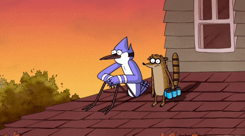

  

#

Me chamo Lucas de Carvalho Barbosa e sou estudante de Análise e Desenvolvimento de Sistemas na Universidade Santa Cecília (UNISANTA), atualmente no 4º semestre. Tenho conhecimentos em programação, desenvolvimento de sistemas, desenvolvimento web, banco de dados e análise de dados. Estou em busca de uma oportunidade de estágio em Tecnologia da Informação para aplicar o que aprendi em projetos reais.

#

<h3 align="left">Connect with me!/h3>

<h3 align="left">My Stack </h3>

  &nbsp;
  &nbsp;
  &nbsp;
  &nbsp;
  &nbsp;
  &nbsp;
  
  &nbsp;

 

<h3 align="left">GitHub Stats</h3>

  

  

 

<picture align="center">
  <source media="(prefers-color-scheme: dark)" srcset="https://raw.githubusercontent.com/lucas-carvalh0/lucas-carvalh0/output/github-contribution-grid-snake-dark.svg">
  <source media="(prefers-color-scheme: light)" srcset="https://raw.githubusercontent.com/lucas-carvalh0/lucas-carvalh0/output/github-contribution-grid-snake-dark.svg">
  
</picture>
